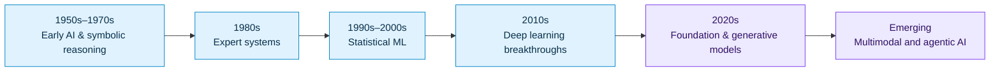
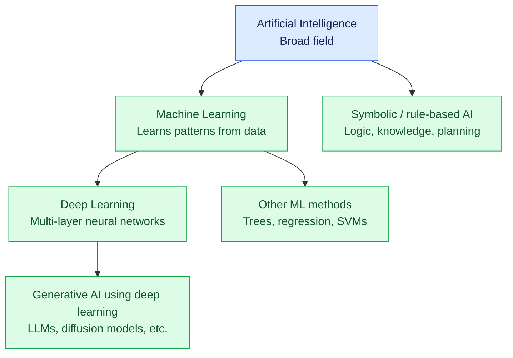
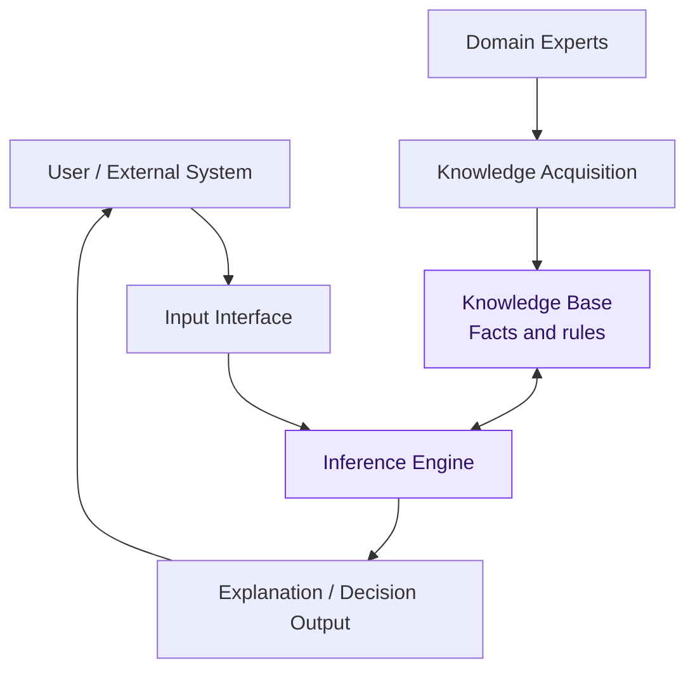
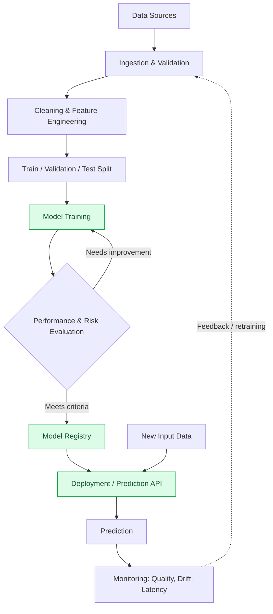
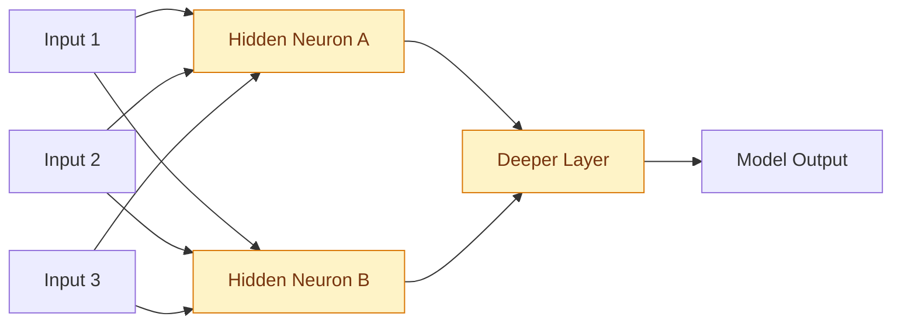
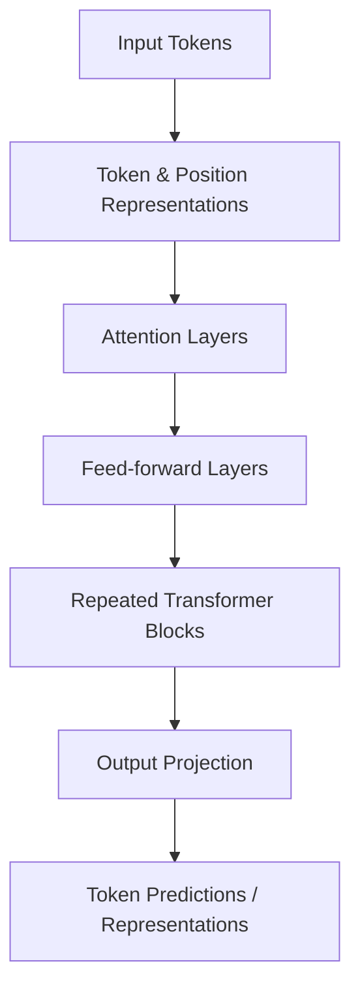
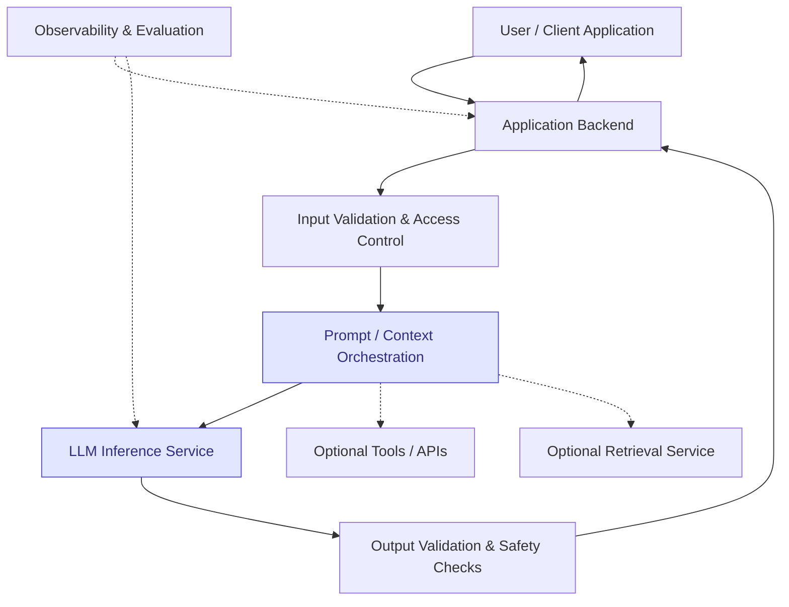
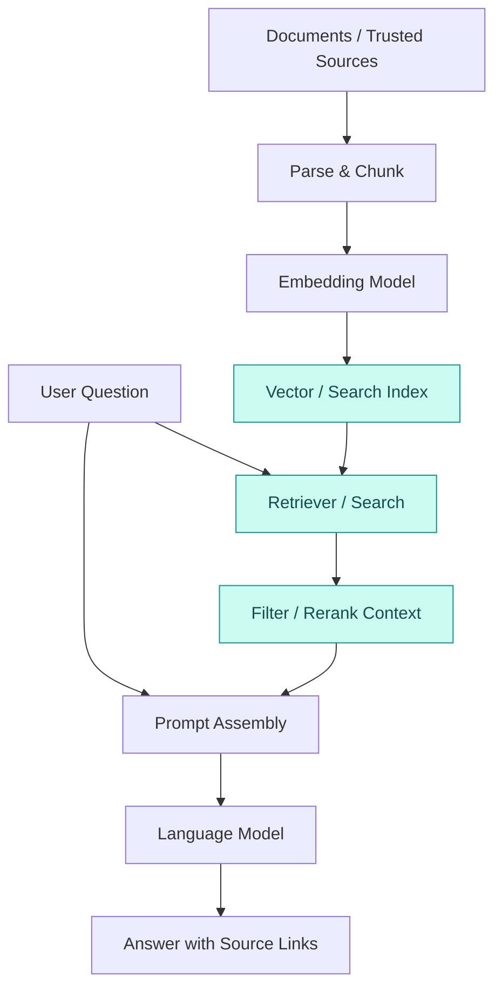
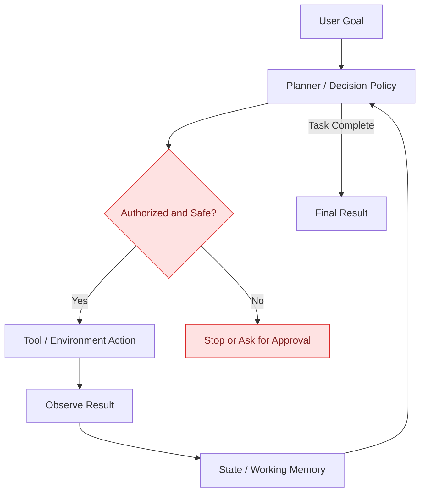
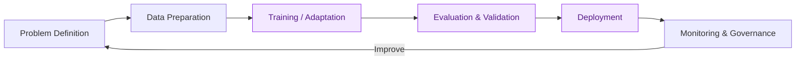

# Artificial Intelligence: Concepts, Evolution & System Architecture

<div align="center">

**A visual, research-oriented guide to Artificial Intelligence (AI), Machine Learning (ML), Deep Learning (DL), and Generative AI.**

   

</div>

> **Scope:** Educational overview of established AI methods and common reference architectures. Diagrams are illustrative; there is no single architecture that fits every AI system.

## Table of Contents

1. [What is Artificial Intelligence?](#1-what-is-artificial-intelligence)
2. [Visual Evolution of AI](#2-visual-evolution-of-ai)
3. [AI vs ML vs DL vs Generative AI](#3-ai-vs-ml-vs-dl-vs-generative-ai)
4. [Types of AI](#4-types-of-ai)
5. [Core AI Techniques](#5-core-ai-techniques)
6. [Traditional AI System Architecture](#6-traditional-ai-system-architecture)
7. [Machine Learning Pipeline Architecture](#7-machine-learning-pipeline-architecture)
8. [Deep Learning Architecture](#8-deep-learning-architecture)
9. [Generative AI and LLM Application Architecture](#9-generative-ai-and-llm-application-architecture)
10. [Retrieval-Augmented Generation (RAG)](#10-retrieval-augmented-generation-rag)
11. [AI Agents Architecture](#11-ai-agents-architecture)
12. [AI Lifecycle and MLOps](#12-ai-lifecycle-and-mlops)
13. [Comparative Table](#13-comparative-table)
14. [Benefits, Limitations, and Responsible AI](#14-benefits-limitations-and-responsible-ai)
15. [Research Directions](#15-research-directions)
16. [Research References](#16-research-references)

---

## 1. What is Artificial Intelligence?

**Artificial Intelligence (AI)** is a field of computer science concerned with building systems that perform tasks associated with intelligent behavior, such as perception, reasoning, learning, planning, language understanding, and decision-making.

AI includes rule-based programs as well as statistical and neural-network approaches. **Not all AI uses machine learning**, and **not all AI generates content**.

**Example uses:** fraud detection, image recognition, language translation, medical decision support, industrial optimization, recommender systems, and autonomous robotics.

## 2. Visual Evolution of AI



**Important:** These periods overlap. Symbolic AI, statistical ML, deep learning, and generative AI are still used alongside one another.

## 3. AI vs ML vs DL vs Generative AI



| Concept | Basic idea | Examples |
|---|---|---|
| AI | Systems exhibiting capabilities such as reasoning or perception | Search, planning, expert systems |
| ML | Models learn patterns from examples | Spam filters, recommendation |
| DL | ML using deep neural networks | Speech recognition, computer vision |
| Generative AI | Models produce new content based on learned patterns | Text, images, audio, code |
| LLM | Large language model trained on language-related data | Chatbots, summarization, coding assistance |

> The diagram shows a common modern relationship, not a strict mathematical taxonomy: generative methods also existed before deep learning.

## 4. Types of AI

### By scope of capability

- **Artificial Narrow Intelligence (ANI):** AI designed for particular tasks; this is the category of today's deployed AI systems.
- **Artificial General Intelligence (AGI):** A proposed level of broad, human-comparable task versatility; there is no universally accepted test or agreed milestone.
- **Artificial Superintelligence (ASI):** A hypothetical system exceeding human capabilities across many domains.

### By learning method

- **Supervised learning:** Learn from labeled examples.
- **Unsupervised learning:** Discover structure in unlabeled data.
- **Self-supervised learning:** Derive learning signals from the data itself.
- **Reinforcement learning:** Optimize actions using reward or feedback.

## 5. Core AI Techniques

| Technique | Typical purpose | Examples |
|---|---|---|
| Search and planning | Explore possible states and actions | Route planning, game playing |
| Knowledge representation | Encode concepts and relationships | Ontologies, knowledge graphs |
| Probabilistic reasoning | Model uncertainty | Bayesian networks |
| Classical machine learning | Prediction and clustering | Random forests, logistic regression, k-means |
| Neural networks | Learn complex representations | CNNs, transformers |
| Natural language processing | Process and generate language | Classification, translation, summarization |
| Computer vision | Interpret visual information | Detection, segmentation |
| Reinforcement learning | Learn sequential decisions | Robotics, resource allocation |

## 6. Traditional AI System Architecture

Rule-based **expert systems** use explicitly represented knowledge and inference logic.



**Components:** input interface, knowledge base, inference engine, knowledge acquisition process, and outputs. These systems can be interpretable but depend on carefully maintained rules.

## 7. Machine Learning Pipeline Architecture

A typical **predictive ML** architecture separates model development from production inference.



**Research note:** Data splitting must avoid leakage; evaluation should consider task-specific accuracy, robustness, fairness, security, latency, and operational cost.

## 8. Deep Learning Architecture

A feed-forward neural network transforms inputs across multiple learned layers. Real architectures may be much more complex (CNN, RNN, transformer, etc.).



**Learning process:** forward pass → loss calculation → backpropagation → optimizer update → repeated training iterations.

### Simplified transformer architecture



This is a **conceptual transformer block overview**, not a complete diagram of every transformer variant. Decoder-only, encoder-only, and encoder–decoder models differ.

## 9. Generative AI and LLM Application Architecture

A common LLM application uses a model provider or locally hosted model, application orchestration, and safety controls.



**Key considerations:** data governance, hallucination risk, prompt injection, authorization for tool calls, model evaluation, cost, and latency.

## 10. Retrieval-Augmented Generation (RAG)

RAG helps a language model respond using retrieved source material. Retrieval can improve grounding but **does not guarantee correctness**.



**Architecture components:** document ingestion, parsing, embeddings or keyword indexing, retrieval, context selection, LLM inference, and response verification.

## 11. AI Agents Architecture

An **AI agent** combines a model or decision engine with tools and a control loop to carry out multi-step tasks.



**Recommended safeguard:** require human approval for consequential external actions and apply minimum-necessary permissions to tools.

## 12. AI Lifecycle and MLOps



**MLOps** supports reproducible experiments, versioned datasets/models, deployment automation, monitoring, and incident response. **LLMOps** extends these practices to foundation-model applications, prompt/version management, retrieval quality, and generation-specific evaluation.

## 13. Comparative Table

| Dimension | Rule-based AI | Classical ML | Deep Learning | Generative AI / LLMs |
|---|---|---|---|---|
| Primary mechanism | Human-authored rules | Statistical pattern learning | Multi-layer neural networks | Generative learned models |
| Training data | Not always required | Usually required | Often large datasets | Often large-scale pretraining |
| Typical output | Decisions/explanations | Predictions or clusters | Predictions or learned features | Text, images, audio, code, etc. |
| Interpretability | Often high | Varies by model | Often challenging | Often challenging |
| Computation | Often modest | Low to medium | Medium to very high | Medium to very high |
| Example | Troubleshooting rules | Fraud classifier | Image classifier | AI writing assistant |

*These are general tendencies, not strict constraints.*

## 14. Benefits, Limitations, and Responsible AI

### Benefits
- Automates repetitive analysis and supports decision-making.
- Finds patterns in large datasets and helps with forecasting.
- Powers accessible language, vision, and assistive technologies.
- Enables new creative and scientific workflows.

### Limitations and risks
- **Bias and fairness:** Data and system design can create unequal outcomes.
- **Reliability:** Models can fail on new distributions or produce fabricated responses.
- **Privacy:** Personal or confidential data needs appropriate safeguards.
- **Security:** Model theft, data poisoning, prompt injection, and unsafe tool execution are concerns.
- **Transparency:** Complex models can be difficult to audit and explain.
- **Environment and cost:** Training and serving models consume computing resources and energy.

A responsible development process should include **risk identification, testing, human oversight, monitoring, and documented limitations**.

## 15. Research Directions

1. **Trustworthy and interpretable AI** — evaluation, transparency, accountability, and audits.
2. **Efficient AI** — smaller models, quantization, hardware optimization, and energy reduction.
3. **Multimodal AI** — integrated language, visual, audio, and sensor processing.
4. **Agentic systems** — planning and safe interaction with software tools.
5. **On-device and edge AI** — low-latency, privacy-conscious inference.
6. **AI for science** — discovery and modeling across scientific disciplines.
7. **Neuro-symbolic AI** — combining learned representations with symbolic reasoning.

## 16. Research References

**Foundational works**

1. Turing, A. M. (1950). *Computing Machinery and Intelligence*. *Mind*. [DOI](https://doi.org/10.1093/mind/LIX.236.433).
2. LeCun, Y., Bengio, Y., & Hinton, G. (2015). *Deep learning*. *Nature*, 521, 436–444. [DOI](https://doi.org/10.1038/nature14539).
3. Vaswani, A., et al. (2017). *Attention Is All You Need*. [arXiv](https://arxiv.org/abs/1706.03762).
4. Brown, T. B., et al. (2020). *Language Models are Few-Shot Learners*. [arXiv](https://arxiv.org/abs/2005.14165).
5. Lewis, P., et al. (2020). *Retrieval-Augmented Generation for Knowledge-Intensive NLP Tasks*. [arXiv](https://arxiv.org/abs/2005.11401).

**Standards and governance**

6. NIST (2023). *Artificial Intelligence Risk Management Framework (AI RMF 1.0).* [NIST AI RMF](https://www.nist.gov/itl/ai-risk-management-framework).
7. OECD. *OECD AI Principles*. [OECD AI](https://oecd.ai/en/ai-principles).
8. ISO/IEC 42001:2023. *Artificial intelligence management system*. [ISO](https://www.iso.org/standard/81230.html).

---

## Suggested Repository Structure

```text
artificial-intelligence/
├── README.md           # Main research overview and diagrams
└── LICENSE             # Optional license file
```

---

<div align="center">

**Artificial Intelligence: from symbolic reasoning to learning systems, foundation models, and tool-using agents.**

*Last updated: October 2026 · Educational research guide*

</div>
